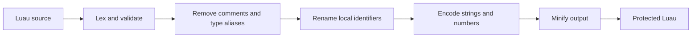

<div align="center">

# 🛡️ RealObfuscator

### A layered Luau obfuscator built for Roblox projects

Transform readable Luau into protected code directly from a fast, standalone Rust command-line application.

[](https://github.com/linkoro57/RealObfuscator)
[](https://www.rust-lang.org/)
[](https://luau.org/)
[](LICENSE)

[Quick start](#-quick-start) · [Protection modes](#️-protection-modes) · [Library API](#-library-api) · [Tests](#-tests)

</div>

> [!IMPORTANT]
> Keep your original source and test every generated script in Roblox Studio before publishing it. Obfuscation raises the cost of analysis; it cannot make client-side code impossible to recover.

## ✨ Highlights

| 🔐 Layered protection | ⚡ Native executable | 🎲 Build diversification |
| :--- | :--- | :--- |
| Identifier renaming, string encoding, number transformations, minification, and build signatures. | A standalone Rust executable with no Python runtime or third-party Rust dependency. | Private random seeds and generated identifiers vary between release builds. |

| 🧩 Luau-aware lexer | 📁 Project processing | 🧪 Runtime-tested |
| :--- | :--- | :--- |
| Preserves strings and directives while rejecting unsupported syntax instead of silently changing it. | Recursively processes `.lua` and `.luau` files while preserving relative paths. | Generated code can be checked with the bundled official Luau 0.741 runtime. |

## 🚀 Quick start

### 1. Build

Install the stable Rust toolchain, clone the repository, and compile the release binary:

```bash
git clone https://github.com/linkoro57/RealObfuscator.git
cd RealObfuscator
cargo build --release
```

The executable is written to `target/release/realobfuscator` (`realobfuscator.exe` on Windows).

### 2. Obfuscate

```bash
# Fast default protection
realobfuscator script.luau

# Native protection profile
realobfuscator script.luau --mode native

# Choose the output path
realobfuscator script.luau --output build/script.luau
```

The default output is `script.obf.luau`.

### 3. Process a project

```bash
realobfuscator src --output build
```

Directories are processed recursively. Only `.lua` and `.luau` files are transformed, and their relative paths are preserved.

## 🧱 Protection pipeline



## 🎛️ Protection modes

| Mode | Speed | Output size | Purpose |
| :--- | :---: | :---: | :--- |
| `rename` | ⚡⚡⚡ | Small | Rename local identifiers and minify the source. |
| `lightweight` | ⚡⚡⚡ | Small | Rename identifiers and encode strings. This is the default. |
| `native` | ⚡⚡ | Medium | Enable the complete native transformation profile. |
| `vm` | ⚡⚡ | Medium | Use the VM-compatible hardened configuration and VM build signature. |

```bash
realobfuscator script.luau --mode rename
realobfuscator script.luau --mode lightweight
realobfuscator script.luau --mode native
realobfuscator script.luau --mode vm
```

Show compatibility flags and advanced settings with:

```bash
realobfuscator --help-all
```

## 🦀 Library API

```rust
use realobfuscator::{ObfuscationConfig, Obfuscator, ProtectionLevel};

fn main() -> Result<(), Box<dyn std::error::Error>> {
    let config = ObfuscationConfig::default()
        .with_seed(12345)
        .with_level(ProtectionLevel::Maximum);
    let source = r#"print("Hello, Roblox!")"#;
    let protected = Obfuscator::new(config).obfuscate(source)?;
    std::fs::write("script.obf.luau", protected)?;
    Ok(())
}
```

| Level | Pipeline |
| :--- | :--- |
| `Minimal` | Identifier and string transformations. |
| `Standard` | Minimal profile plus standard hardening settings. |
| `Maximum` | Complete native profile. |
| `Paranoid` | VM-compatible hardened profile. |

For reproducible development builds, call `.with_seed(...)`. Omit the seed for release builds so RealObfuscator uses private process randomness.

## 🧪 Tests

```bash
cargo test
```

Build an optimized executable with:

```bash
cargo build --release
```

The repository retains `luau.exe` and `luau-compile.exe` under `tests/runtime/0.741` for manual runtime and syntax checks.

## ⚠️ Scope and limitations

- RealObfuscator targets Luau and Roblox-oriented workflows.
- Backtick-interpolated strings are currently rejected.
- Test generated scripts on the target device before publishing them.
- No client-side obfuscator can guarantee secrecy against a determined attacker.
- Server-authoritative design remains the primary protection for valuable game logic and data.

## 📄 License

Distributed under the [GNU General Public License v3.0](LICENSE).

<div align="center">

**Protect the implementation. Keep the behavior.**

</div>

