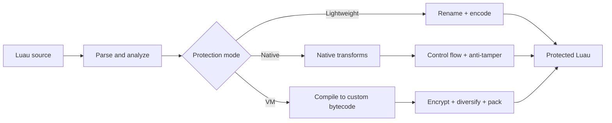

<div align="center">

# 🛡️ RealObfuscator

### A layered Luau obfuscator built for Roblox projects

Transform readable Luau into hardened native code or build-specific virtualized bytecode — directly from the command line.

[](https://github.com/linkoro57/RealObfuscator/actions/workflows/tests.yml)
[](https://github.com/linkoro57/RealObfuscator)
[](https://www.python.org/downloads/)
[](https://luau.org/)
[](LICENSE)

[Quick start](#-quick-start) · [Protection modes](#-protection-modes) · [VM hardening](#-vm-hardening) · [Library API](#-library-api) · [Tests](#-tests)

</div>

> [!IMPORTANT]
> Keep your original source and test every generated script in Roblox Studio before publishing it. Obfuscation raises the cost of analysis; it cannot make client-side code impossible to recover.

## ✨ Highlights

| 🔐 Layered protection | ⚙️ Custom virtual machine | 🎲 Build diversification |
| :--- | :--- | :--- |
| Identifier renaming, string and number encoding, control-flow transformations, dead code, indirection, and integrity checks. | Compiles Luau into encrypted bytecode interpreted by a generated, build-specific runtime. | Private random seeds, shuffled opcodes, operand layouts, aliases, keys, handlers, and constant pools vary between builds. |

| 🧩 Hardened constants | 📦 Compact payloads | 🧪 Runtime-tested |
| :--- | :--- | :--- |
| Constants use evolving per-value whitening derived from their key, index, position, and length. | Optional Base64 packing reduces large bytecode and encrypted-constant representations. | The test suite executes generated programs with the official Luau runtime across supported Python versions. |

## 🚀 Quick start

### 1. Install

```bash
git clone https://github.com/linkoro57/RealObfuscator.git
cd RealObfuscator
python -m pip install -r requirements.txt
```

Optionally install the `realobfuscator` command system-wide or in a virtual environment:

```bash
python -m pip install .
```

### 2. Obfuscate

```bash
# Fast default protection
realobfuscator script.luau

# Maximum VM protection
realobfuscator script.luau --mode vm

# Choose the output path
realobfuscator script.luau --mode vm --output build/script.luau
```

The default output is `script.obf.luau`. Without package installation, replace `realobfuscator` with `python main.py`.

### 3. Process a project

```bash
realobfuscator src --output build
```

Directories are processed recursively. Only `.lua` and `.luau` files are transformed, and their relative paths are preserved.

## 🧱 Protection pipeline



## 🎚️ Protection modes

| Mode | Speed | Output size | Protection | Best suited for |
| :--- | :---: | :---: | :---: | :--- |
| `rename` | ⚡⚡⚡ | Small | ●○○○ | Development builds and simple symbol cleanup |
| `lightweight` | ⚡⚡⚡ | Small | ●●○○ | Scripts where startup speed and size matter most |
| `native` | ⚡⚡ | Medium | ●●●○ | Stronger protection without a virtual machine |
| `vm` | ⚡ | Large | ●●●● | Sensitive logic where resistance to static analysis is the priority |

```bash
realobfuscator script.luau --mode rename
realobfuscator script.luau --mode lightweight
realobfuscator script.luau --mode native
realobfuscator script.luau --mode vm
```

> [!TIP]
> Start with `lightweight` or `native`. Use `vm` selectively for sensitive modules, because virtualization trades runtime speed and output size for stronger protection.

## 🖥️ VM hardening

Every hardened VM build receives a different runtime layout. The maximum profile combines:

- build-specific opcode values and aliases;
- diversified operand layouts and handler variants;
- rolling encrypted bytecode reads;
- per-prototype keys and partitioned constant pools;
- fused instructions and generated superinstructions;
- payload integrity verification;
- lazy decoding of encrypted string and numeric constants;
- evolving constant whitening that separates identical positions and shared prefixes;
- compact bytecode representation by default.

### Rolling or cached bytecode

```bash
# Stronger default: decode while reading
realobfuscator script.luau --mode vm --vm-rolling

# Faster execution: decode once per function
realobfuscator script.luau --mode vm --vm-cached
```

### Packed or unpacked payloads

```bash
# Also pack encrypted constants for smaller output
realobfuscator script.luau --mode vm --vm-packed

# Keep bytecode and constants as unpacked tables/strings
realobfuscator script.luau --mode vm --vm-unpacked
```

Show the complete set of advanced options and compatibility aliases:

```bash
realobfuscator --help-all
```

## 🐍 Library API

```python
from config import ObfuscationConfig, ProtectionLevel
from obfuscator import Obfuscator

config = ObfuscationConfig(level=ProtectionLevel.PARANOID)
source = 'print("Hello, Roblox!")'
protected = Obfuscator(config).obfuscate(source)

with open("script.obf.luau", "w", encoding="utf-8") as output:
    output.write(protected)
```

| Level | Pipeline |
| :--- | :--- |
| `MINIMAL` | Identifier, string, and number transformations |
| `STANDARD` | Minimal layers plus control flow, predicates, and dead code |
| `MAXIMUM` | Standard layers plus indirection and anti-tamper checks |
| `PARANOID` | Maximum-hardened custom VM pipeline |

For reproducible development builds, provide `seed=...`. Omit the seed for releases so RealObfuscator uses private operating-system randomness.

## 🧪 Tests

```bash
python -m unittest discover -s tests -v
```

GitHub Actions tests every push and pull request on Python 3.9, 3.11, and 3.13. Runtime tests use the official [Luau 0.741 tools](https://github.com/luau-lang/luau/releases/tag/0.741).

Place the executable in `tests/runtime/0.741/` or set `LUAU_BIN`. To make a missing runtime fail the suite:

```powershell
$env:REALOBFUSCATOR_REQUIRE_RUNTIME = "1"
python -m unittest discover -s tests -v
```

## ⚠️ Scope and limitations

- RealObfuscator targets Luau and Roblox-oriented workflows.
- Virtualized code has a runtime and size cost; benchmark it on the target device.
- No client-side obfuscator can guarantee secrecy against a determined attacker.
- Server-authoritative design remains the primary protection for valuable game logic and data.

## 📄 License

Distributed under the [GNU General Public License v3.0](LICENSE).

<div align="center">

**Protect the implementation. Keep the behavior.**

</div>
